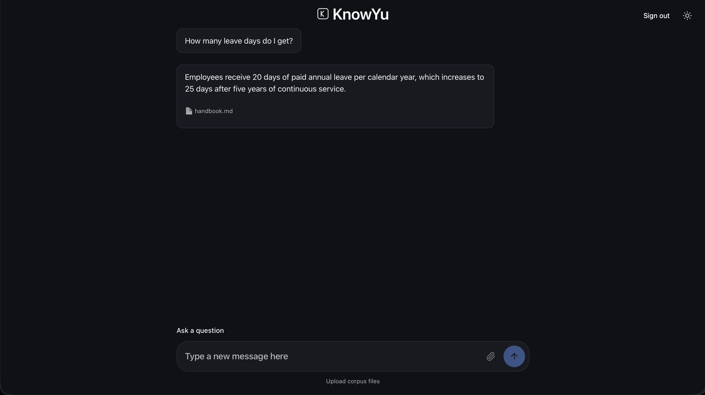
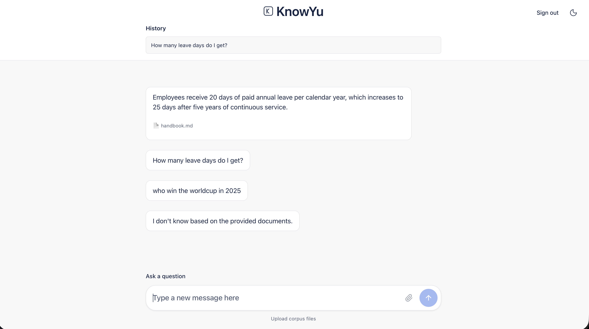

# KnowYu

A retrieval-augmented question-answering bot that answers questions from your documents — with citations you can verify, and honest refusals when the answer isn't in the corpus.

Supports PDF and Markdown today. Image support (JPG, PNG, WebP) is planned for v2 — OCR runs entirely in the browser, so the server never receives an image binary.

## The problem

Most RAG bots hallucinate. When they can't find an answer, they invent one. KnowYu structurally cannot.

## What makes it different

Three gates prevent hallucination:

1. **Pre-LLM threshold** — if no chunk scores above 0.65 cosine similarity, the LLM is never called. The user gets "I don't know based on the provided documents."

2. **Prompt contract** — the system prompt forbids outside knowledge, wraps context in XML delimiters, and requires an exact refusal string.

3. **Post-LLM citation verification** — every citation the model returns is checked against the retrieved chunks. Fabricated citations are stripped before the answer reaches the user.

The result: the bot can be wrong, but it cannot be confidently wrong.

## Supported inputs

| Input | Status | Notes |
|---|---|---|
| PDF | ✅ Supported | Text-based PDFs only |
| Markdown (.md, .markdown) | ✅ Supported | UTF-8 text |
| Images (.jpg, .jpeg, .png, .webp) | 📋 Planned for v2 | OCR runs client-side; image never leaves the browser |
| Handwritten notes | ⚠️ Limited | OCR works best on printed text |

## Preview

### Light mode


### Dark mode


### Working demo — answer with citation


### Working demo — honest refusal


The refusal case is the differentiator. Most RAG bots would invent an answer. KnowYu returns "I don't know based on the provided documents."

## Stack

| Layer | Technology |
|---|---|
| Framework | Next.js 15 (App Router, React 18) |
| Database | Supabase Postgres + pgvector (HNSW index, cosine distance) |
| LLM | Google Gemini 3.5 Flash-Lite |
| Embeddings | Google Gemini Embedding 001 (1536 dimensions) |
| Auth | Supabase Auth (magic links) |
| Rate limiting | Upstash Redis |
| Hosting | Vercel-ready |
| Testing | Vitest (20 unit tests) |
| Icons | Lucide React |

## Documentation

Twelve planning documents in `docs/`:

- [PRD](docs/PRD.md) — product requirements, success metrics
- [TRD](docs/TRD.md) — technical requirements, data model
- [System Design](docs/SYSTEM_DESIGN.md) — architecture, tradeoffs
- [Security](docs/SECURITY.md) — threat model, prompt injection defense
- [API Design](docs/API_DESIGN.md) — versioning, error codes, streaming
- [Backend Rules](docs/BACKEND_RULES.md) — coding standards
- [Frontend Rules](docs/FRONTEND_RULES.md) — component standards
- [Design Rules](docs/DESIGN_RULES.md) — colors, typography, devices
- [Database Rules](docs/DATABASE_RULES.md) — schema, RLS, indexes
- [Testing Rules](docs/TESTING_RULES.md) — test pyramid, CI
- [Upload Security](docs/UPLOAD_SECURITY.md) — file upload threat model
- [Image Upload Security](docs/IMAGE_UPLOAD_SECURITY.md) — image OCR threat model

## Running locally

Prerequisites: Node.js 20+, Docker, a free Gemini API key, and a free Upstash Redis database.

```bash
git clone https://github.com/RISHI9922/KnowYu
cd KnowYu
npm install
cp .env.example .env.local
