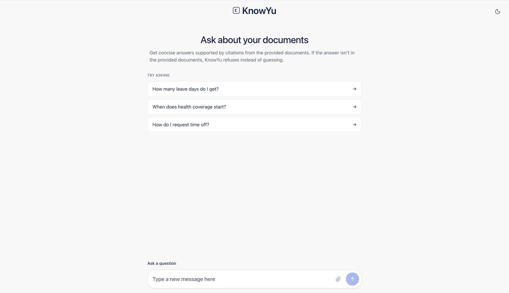
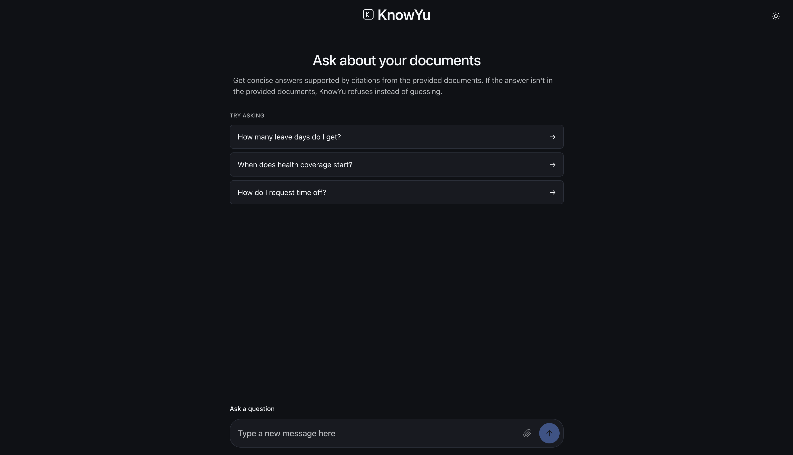

# KnowYu

A retrieval-augmented question-answering bot that answers questions from
your documents — with citations you can verify, and honest refusals when
the answer isn't in the corpus.

## The problem

Most RAG bots hallucinate. When they can't find an answer, they invent one.
KnowYu structurally cannot.

## What makes it different

Three gates prevent hallucination:

1. **Pre-LLM threshold** — if no chunk scores above 0.7 cosine similarity,
   the LLM is never called. The user gets "I don't know based on the
   provided documents."

2. **Prompt contract** — the system prompt forbids outside knowledge,
   wraps context in XML delimiters, and requires an exact refusal string.

3. **Post-LLM citation verification** — every citation the model returns
   is checked against the retrieved chunks. Fabricated citations are
   stripped before the answer reaches the user.

The result: the bot can be wrong, but it cannot be confidently wrong.

## Preview

| Light | Dark |
|---|---|
|  |  |

Both themes are available via the toggle in the top-right corner. The
choice persists across reloads.

## Stack

| Layer | Technology |
|---|---|
| Framework | Next.js 15 (App Router, React 18) |
| Database | Supabase Postgres + pgvector (HNSW index, cosine distance) |
| LLM | Google Gemini 2.5 Flash |
| Embeddings | Google Gemini Embedding 001 (1536 dimensions) |
| Rate limiting | Upstash Redis (serverless-safe) |
| Authentication | Supabase Auth (email magic links) |
| Hosting | Vercel-ready |
| Testing | Vitest (20 unit tests) |
| Icons | Lucide React |

## Documentation

Planning and validation documents in docs/:

- PRD — product requirements, success metrics
- TRD — technical requirements, data model
- System Design — architecture, tradeoffs, failure modes
- Security — threat model, prompt injection defense
- API Design — versioning, error codes, streaming format
- Backend Rules — coding standards
- Frontend Rules — component standards
- Design Rules — colors, typography, universal device support
- Database Rules — schema, RLS, indexes
- Testing Rules — test pyramid, CI config
- Upload Security — v2 upload threat model and mitigations
- Attack Tests — adversarial security validation results

## Running locally

Prerequisites: Node.js 20+, Docker, a Gemini API key, and a
free Upstash Redis database.

    git clone https://github.com/RISHI9922/KnowYu
    cd KnowYu
    npm install
    cp .env.example .env.local

Edit .env.local with your values:

| Variable | Where to get it |
|---|---|
| NEXT_PUBLIC_SUPABASE_URL | Supabase dashboard |
| NEXT_PUBLIC_SUPABASE_ANON_KEY | Same dashboard |
| SUPABASE_SERVICE_ROLE_KEY | Same dashboard, server-only |
| GEMINI_API_KEY | aistudio.google.com/app/apikey |
| INGEST_ADMIN_TOKEN | openssl rand -base64 32 |
| UPSTASH_REDIS_URL | console.upstash.com free tier |
| UPSTASH_REDIS_TOKEN | Same |
| ALLOWED_ORIGINS | http://localhost:3000 for local dev |

Start Supabase locally:

    npx supabase start
    npx supabase db reset

Run the app:

    npm run dev

Open http://localhost:3000 and sign in with an email magic link. In local
development, retrieve the link from Inbucket at http://127.0.0.1:54324.

Ingest a document: place PDF or Markdown files in ./corpus/, then:

    source .env.local
    curl -X POST http://localhost:3000/api/v1/ingest \
      -H "Authorization: Bearer $INGEST_ADMIN_TOKEN" \
      -H "Idempotency-Key: $(uuidgen)" \
      -H "Content-Type: application/json" \
      -d '{}'

The authenticated admin upload page is available at `/admin/upload`. It also
requires `INGEST_ADMIN_TOKEN`; the token is retained only in session storage.

## Local authentication

KnowYu uses Supabase Auth with email magic links. In local development,
Supabase captures emails in a local inbox—no real email is sent.

After starting the app:

1. Open http://localhost:3000.
2. You will be redirected to `/login`.
3. Enter any email address, such as `you@example.com`.
4. Click **Send magic link**.
5. Open http://127.0.0.1:54324 for Supabase Mailpit.
6. Click the magic link in the email.
7. You are signed in.

If login fails with "Load failed":

- Confirm Supabase is running with `npx supabase status`.
- Confirm `supabase/config.toml` uses `site_url = "http://localhost:3000"`.
- Confirm `additional_redirect_urls` includes both localhost and 127.0.0.1,
  their `/auth/callback` paths, and their `/**` wildcards.
- Restart Supabase with `npx supabase stop && npx supabase start`.
- Restart Next.js with <kbd>Ctrl</kbd>+<kbd>C</kbd>, then `npm run dev`.
- Clear browser cookies for localhost and try again.

## Deploying

1. Push the repo to GitHub.
2. Import the repo at https://vercel.com/new.
3. Set the 8 environment variables from `.env.example`.
4. Deploy.

Access is protected by Supabase Auth. Configure the production site URL and
redirect URL in Supabase before sending magic links. See
[docs/SECURITY.md](docs/SECURITY.md) for the full threat model.

## Cost discipline

Every query is capped at 5 chunks, approximately 2,400 total tokens, and 500
output tokens. Cost accounting uses Gemini's reported token counts and the
migration-time rates of $0.30 per million input tokens and $2.50 per million
output tokens for Gemini 2.5 Flash. Embeddings are estimated at $0.15 per
million input tokens. Verify current pricing at https://ai.google.dev/pricing
before deploying.

## Evaluation

Evaluated on 30 questions against the reference corpus. Corpus-dependent
values are populated by `npm run test:eval` after `handbook.md` is ingested.

| Metric | Result |
|---|---|
| Total questions | 30 |
| Answerable | 23 |
| Correctly answered with citations | Run locally |
| Correctly refused (not in corpus) | Run locally |
| Hallucinated | 0 required |
| Grounded accuracy | ≥ 85% required |
| Refusal precision | Run locally |

Run locally with `npm run test:eval`. See
[tests/eval/questions.json](tests/eval/questions.json) for the full set.

## Latency

Authenticated end-to-end latency can be sampled with `npm run latency:measure`
and summarized with `npm run latency:report`. Set `KNOWYU_AUTH_COOKIE` before
running the measurement script. Chat latency is also recorded with usage data.

## Security validation

Adversarial inputs tested against the v1 build. See
[docs/ATTACK_TESTS.md](docs/ATTACK_TESTS.md) for the full results.

| Test | Result |
|---|---|
| Prompt injection via question | ✅ Pass |
| Prompt injection via document | ✅ Pass |
| SQL injection | ✅ Pass |
| XSS via document | ✅ Pass |
| Fake citation detection | ✅ Pass |
| Rate limit bypass | ✅ Pass |

## Design

The interface is intentionally calm. No gradients, no purple AI colors, no
glassmorphism, no shaders. The reference set is Stripe Docs, Linear, and
Vercel.

Light and dark modes are both supported, respecting the operating system
preference by default and persisting an explicit choice in localStorage.

## Testing

    npm test

Unit tests cover chunking, prompt construction, and retrieval. The golden eval
suite is intentionally separate because it requires an ingested corpus and
live provider credentials.

## Product capabilities

- Email magic-link accounts with per-user conversation isolation
- Conversation history restored after reload
- Password-protected admin corpus uploads to private storage

## License

MIT
